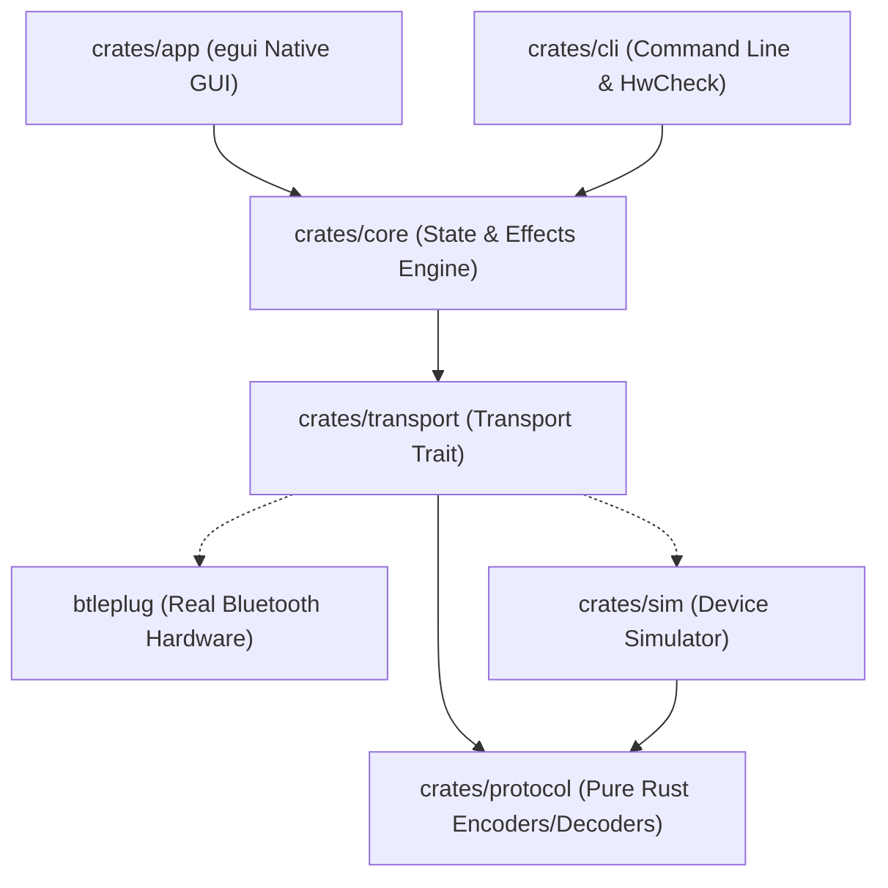

<div align="center">


# Pyxillum

### Clean-Room Native Desktop Controller & CLI for SP621E Bluetooth Low Energy Pixel LED Hardware

[](https://github.com/example/pyxillum/actions)
[](LICENSE)
[](https://github.com/rust-lang/rust)
[](#quickstart)
[](#workspace-architecture)
[](#key-features)
[](#testing-in-simulation-mode-zero-hardware)
[](#compatibility-and-legal-disclaimer)

<p align="center">
  <a href="win-exe/"><strong>Download Windows Binaries</strong></a> &bull;
  <a href="#key-features"><strong>Key Features</strong></a> &bull;
  <a href="#hardware-compatibility-matrix"><strong>Compatibility Matrix</strong></a> &bull;
  <a href="#quickstart"><strong>Quickstart</strong></a> &bull;
  <a href="#workspace-architecture"><strong>Architecture</strong></a> &bull;
  <a href="docs/building-windows.md"><strong>Windows Guide</strong></a> &bull;
  <a href="AGENTS.md"><strong>Agent Context</strong></a>
</p>

</div>

---

## Overview

**Pyxillum** is an open-source, native, cross-platform desktop application and command-line interface written in pure Rust to control Bluetooth Low Energy (BLE) pixel LED controllers of the family associated with the **SP621E Mini Bluetooth Controller** (and related SP6xxE hardware).

Developed under clean-room engineering standards, Pyxillum provides a robust, desktop-class alternative to vendor mobile applications without telemetry, accounts, or cloud dependencies. An in-memory virtual hardware simulator is embedded directly within the application, allowing complete UI, protocol, and command pipeline verification without physical hardware connected.

---

## Key Features

- **Native Desktop Performance**: 100% native Rust architecture with immediate-mode rendering (`egui`/`eframe`) over OpenGL (`glow`), achieving responsive 60 FPS strip animations with a tiny memory footprint (~15 MB RAM).
- **Virtual Hardware Simulator**: Test every feature out of the box. Toggle "Demo Device" in the GUI or pass `--sim` in the CLI to simulate real controller behaviour, timing constraints, and notification streaming.
- **Dynamic Lighting & Scene Presets**: Complete control over static solid colours, master brightness, animation speeds, built-in dynamic patterns (rainbow, meteor, dual snake, breath), and saved scene presets.
- **Hardware Safety Safeguards**: Non-volatile EEPROM/flash modifications (chip driver types, pixel strip length, colour sequence order) are protected behind explicit confirmation flags (`--i-understand-this-changes-the-device`).
- **Paced BLE Write Pipeline**: Enforces a 30 ms write pacing between consecutive unacknowledged packets to avoid controller FIFO buffer overflows.
- **Hardware Verification Pack**: Includes an interactive 7-stage guided testing CLI (`pyxillum hwcheck`) and test plan (`tests/hardware/PLAN.md`) to systematically validate physical controller hardware.

---

## Ready-to-Run Windows Binaries

Pre-compiled standalone 64-bit Windows release executables are maintained directly in the repository under [`win-exe/`](win-exe/):

| Executable | Size | Description |
| :--- | :---: | :--- |
| **[`pyxillum-desktop.exe`](win-exe/pyxillum-desktop.exe)** | ~4.7 MB | Native desktop GUI application (windowed subsystem, High-DPI Per-Monitor v2 manifest, embedded icon). |
| **[`pyxillum.exe`](win-exe/pyxillum.exe)** | ~1.5 MB | Native command-line interface and interactive hardware verification wizard. |

No external runtimes, MSVC redistributables, or installation steps are required. See [`win-exe/README.md`](win-exe/README.md) for usage details.

---

## Hardware Compatibility Matrix

In accordance with strict verification criteria, features and hardware targets carry explicit confidence tags:

- **`OBSERVED-STATIC`**: Extracted directly from decompilation notes and static analysis.
- **`CORROBORATED`**: Confirmed independently across reference implementations.
- **`VERIFIED-HW`**: Verified through live over-the-air execution on physical hardware.

| Controller Model | Protocol Family | Feature Coverage | Confidence | Support Status |
| :--- | :---: | :--- | :---: | :--- |
| **Virtual Device Simulator** | `SP6xxE (Sim)` | Power, RGB, Brightness, Speed, Effects, Notifications | `VERIFIED-HW` | **Verified (Simulator)** |
| **SP621E Mini Controller** | `SP6xxE Standard` | Full protocol mapping (`0xA0` opcodes, `0xFFE0` GATT) | `CORROBORATED` | **Implemented, untested on hardware** |
| **SP611E SPI Controller** | `SP6xxE Standard` | Full protocol mapping | `CORROBORATED` | **Implemented, untested on hardware** |
| **SP620E USB Controller** | `SP6xxE Standard` | Full protocol mapping | `CORROBORATED` | **Implemented, untested on hardware** |

> [!IMPORTANT]
> **Honest Capability Rule**: Under no circumstances is a physical device model labelled as "supported" until verified live on hardware. Until physical validation is complete, all physical controllers remain labelled **"implemented, untested on hardware"**.

---

## Quickstart

### Prerequisites
- **Rust Toolchain**: Rust 1.80.0 or later (MSRV).
- **Operating Systems**: Windows 10/11 (x86_64), macOS 12+, or Linux with BlueZ D-Bus development libraries.
- Comprehensive Windows compilation instructions: [docs/building-windows.md](docs/building-windows.md).

### 1. Launch the Native Desktop GUI
```bash
# Clone the repository
git clone https://github.com/example/pyxillum.git
cd pyxillum

# Launch the desktop application (defaults to virtual simulator)
cargo run -p pyxillum-app
```

### 2. Command-Line Interface (CLI)
```bash
# Scan for physical BLE controllers (or simulate discovery with --sim)
cargo run -p pyxillum-cli -- scan --sim

# Query device status
cargo run -p pyxillum-cli -- status --sim

# Set solid RGB colour (Orange: 255, 120, 0)
cargo run -p pyxillum-cli -- color 255 120 0 --sim

# Adjust brightness (0 to 255)
cargo run -p pyxillum-cli -- brightness 180 --sim

# Select effect pattern (Effect 1 = Rainbow Sweep at Speed 7)
cargo run -p pyxillum-cli -- effect 1 --speed 7 --sim

# Run the 7-stage interactive hardware verification wizard
cargo run -p pyxillum-cli -- hwcheck --sim
```

---

## Testing in Simulation Mode (Zero Hardware)

Pyxillum features a faithful in-memory virtual SP621E hardware simulator (`crates/sim`), permitting complete state machine testing, command rate-limit checking, and 60 FPS pixel buffer rendering without requiring physical hardware:

```bash
# Test power toggling on the virtual device
cargo run -p pyxillum-cli -- power on --sim
cargo run -p pyxillum-cli -- power off --sim

# Test safety-gate rejection on persistent parameters
cargo run -p pyxillum-cli -- configure --length 60 --sim

# Authorise persistent parameter modification
cargo run -p pyxillum-cli -- configure --length 60 --i-understand-this-changes-the-device --sim
```

---

## Workspace Architecture

The project is structured as a decoupled Cargo workspace with strict crate boundaries:



```text
pyxillum/
├── crates/
│   ├── protocol/      Pure functional codec (#![forbid(unsafe_code)], zero I/O)
│   ├── sim/           In-memory virtual SP621E hardware simulator & validator
│   ├── transport/     Transport trait with SimTransport and BtleplugTransport
│   ├── core/          Device coordination, effects engine, and scene persistence
│   ├── cli/           Command-line application and hwcheck verification runner
│   └── app/           Native desktop GUI presentation layer (eframe/egui)
├── xtask/             Repository check and packaging automation
├── assets/            Vector SVGs, high-resolution PNGs, Windows .ico, and WiX MSI bitmaps
├── win-exe/           Dedicated staging directory for latest Windows release executables
├── tests/
│   ├── vectors/       Static-derived JSON protocol test vectors
│   └── hardware/      Hardware verification checklist and test plan (PLAN.md)
└── docs/              Architecture, protocol specification, ADRs, legal notes
```

For complete architectural details, see [docs/architecture.md](docs/architecture.md).

---

## Developer Workflows (`cargo xtask`)

Repository maintenance and quality checks are orchestrated via `cargo xtask`:

```bash
# 1. Complete health check (rustfmt, Clippy -D warnings, test suite)
cargo xtask check

# 2. Run all workspace unit tests, proptests, and static vector harnesses
cargo xtask test

# 3. Format code according to rustfmt standards
cargo xtask fmt

# 4. Compile release binaries and stage into dist/ and win-exe/
cargo xtask package

# 5. Build native Windows MSI installer package via WiX Toolset
cargo xtask msi

# 6. Synchronise compiled release binaries directly to win-exe/ and dist/
cargo xtask sync-exe
```

---

## Compatibility and Legal Disclaimer

**Independent Clean-Room Implementation**: Pyxillum is an entirely independent, clean-room reverse-engineered open-source project created solely for hardware interoperability. It is not affiliated with, authorised by, endorsed by, or in any way associated with the manufacturers of any physical pixel LED controllers or the developers of any proprietary companion mobile applications.

All hardware model designations (such as "SP621E", "SP611E", "SP620E") are used solely in a factual, nominative sense to indicate device compatibility under international reverse-engineering and interoperability statutory protections:
- **European Union**: Directive 2009/24/EC Article 6 (Decompilation for Interoperability).
- **United States**: 17 U.S.C. § 1201(f) (Reverse Engineering for Interoperability).
- **India**: Section 52(1)(ab) of the Copyright Act, 1957.

For comprehensive legal analysis, refer to [docs/legal-notes.md](docs/legal-notes.md).

---

## Limitation of Liability & Legal Immunity

This project is distributed under the GNU Affero General Public License v3.0 (`AGPL-3.0-or-later`). To the maximum extent permitted by applicable law:

1. **Disclaimer of Warranty**: The software is provided "AS IS", WITHOUT WARRANTY OF ANY KIND, EXPRESS OR IMPLIED, INCLUDING BUT NOT LIMITED TO THE WARRANTIES OF MERCHANTABILITY, FITNESS FOR A PARTICULAR PURPOSE, AND NON-INFRINGEMENT.
2. **Limitation of Liability**: IN NO EVENT SHALL THE AUTHORS, MAINTAINERS, CONTRIBUTORS, OR COPYRIGHT HOLDERS BE LIABLE FOR ANY CLAIM, DAMAGES, LOSS OF DATA, DEVICE MALFUNCTION, OR OTHER LIABILITY, WHETHER IN AN ACTION OF CONTRACT, TORT, OR OTHERWISE, ARISING FROM, OUT OF, OR IN CONNECTION WITH THE SOFTWARE OR THE USE OR OTHER DEALINGS IN THE SOFTWARE.
3. **No Proprietary Assets**: This repository contains zero proprietary binary blobs, zero decompiled source code, zero third-party trade dress, and zero copyrighted artwork or strings.

---

## Agent and Developer Context

For comprehensive technical context, architectural rules, confidence tags, and workflow guidance for automated tools and AI assistants, refer to [AGENTS.md](AGENTS.md).

---

## Licence

Pyxillum is licensed under the **GNU Affero General Public License v3.0** (`AGPL-3.0-or-later`). See the [LICENSE](LICENSE) file for complete terms.
