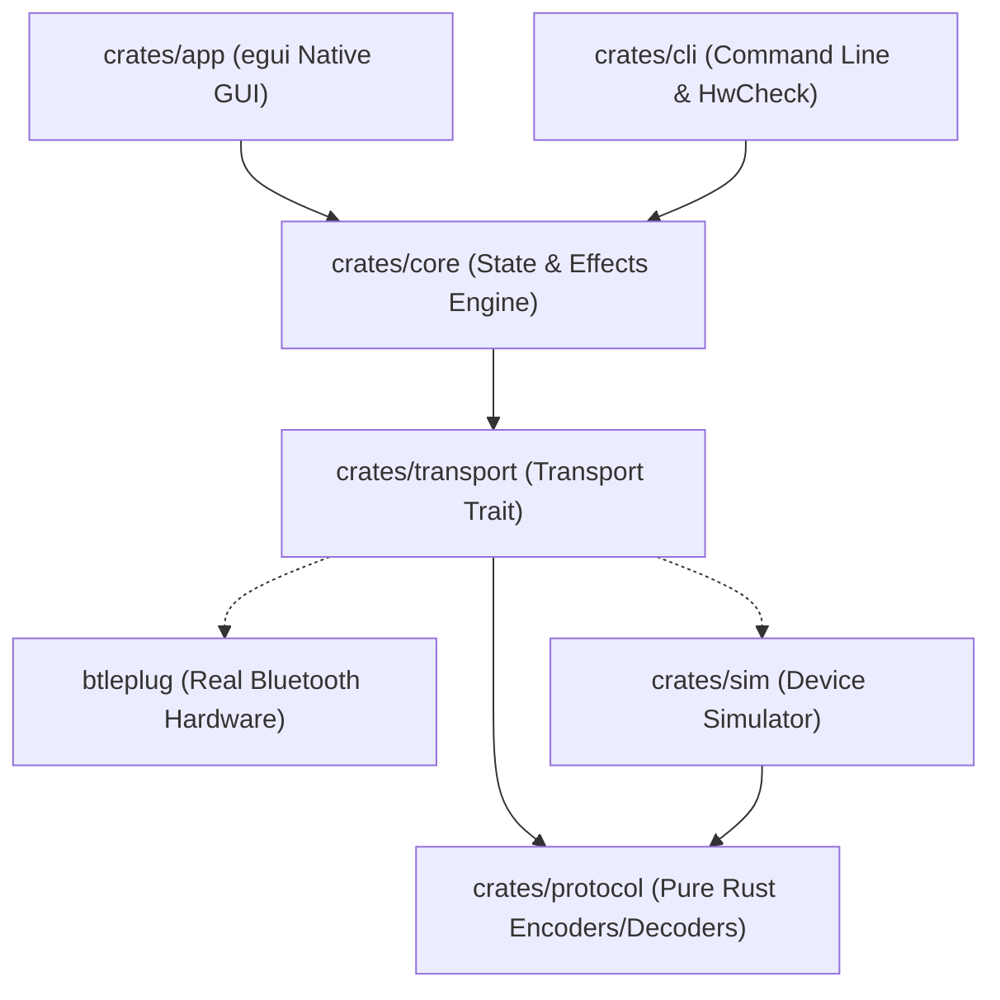

# Pyxillum System Architecture

**Project**: Pyxillum  
**Target Architecture**: Cross-Platform Native Desktop Application (Windows, macOS, Linux)  
**Language & Toolchain**: Rust 1.99+ (MSRV: 1.80.0), Cargo Workspace  
**Licence**: GNU Affero General Public License v3.0 (`AGPL-3.0-or-later`)  

---

## 1. Workspace Crate Layout and Separation of Concerns

### 1.1 Crate Responsibilities

#### `crates/protocol`
- **Scope**: Pure functional protocol codec.
- **Constraints**: `#![forbid(unsafe_code)]`, zero I/O, zero async, zero operating system dependencies.
- **Responsibilities**:
  - Strongly typed commands (`Command::Power`, `Command::SetColor`, `Command::SetBrightness`, `Command::SetEffect`, etc.).
  - Serialization into `0xA0` byte frames.
  - Streaming notification chunk assembler (`0x53 0x43`) and status payload parser.
  - Unit tests, `proptest` generative property tests, static-derived vector test harnesses.

#### `crates/sim`
- **Scope**: In-memory virtual SP621E hardware simulator.
- **Responsibilities**:
  - Implements the complete protocol state machine.
  - Validates every received packet; rejects malformed lengths or invalid opcodes.
  - Tracks internal virtual state (power, RGB, brightness, speed, active effect, pixel buffer).
  - Emits chunked notification frames (`0x53 0x43`) upon query or state change.
  - Enforces write pacing and detects simulated buffer overflow violations.
  - Provides a 60 FPS simulated LED frame buffer for real-time visualization.

#### `crates/transport`
- **Scope**: Asynchronous I/O abstraction.
- **Responsibilities**:
  - Defines the core asynchronous `Transport` trait.
  - `BtleplugTransport`: Communicates with real BLE controllers using `btleplug`. Implements software-side filtering (manufacturer ID `0x5053`, service `0xFFE0`).
  - `SimTransport`: Routes packets directly to `crates/sim::DeviceSimulator` over memory channels without requiring Bluetooth hardware.

#### `crates/core`
- **Scope**: Device state management, lighting patterns, scenes, and background workers.
- **Responsibilities**:
  - High-level device controller managing connection retries, state caching, and command dispatch.
  - Dynamic pattern generation engine (Rainbow, Chasing, Breathing, Comet, etc.) producing real-time pixel buffers.
  - Desktop audio capture hook for sound-reactive lighting.
  - Versioned JSON configuration persistence (per-OS standard data directories).

#### `crates/cli`
- **Scope**: Command-line interface and diagnostic runner.
- **Responsibilities**:
  - Device scanning, connection, and single-shot command invocation.
  - Interactive hardware verification pack runner (`hwcheck`).
  - Protocol packet inspection and vector diffing utilities.

#### `crates/app`
- **Scope**: Native desktop GUI application.
- **Responsibilities**:
  - Native windowing, rendering, and styling using `egui` and `eframe`.
  - Virtual LED Strip visualizer rendering addressable pixels at 60 FPS.
  - Interactive colour wheel, brightness/speed sliders, effect palettes, and log inspection drawer.
  - "Demo Device" toggle allowing full application exploration without hardware.
  - Fully asynchronous: communicates with `crates/core` over non-blocking crossbeam channels.

#### `xtask`
- **Scope**: Automation runner for development workflows.
- **Responsibilities**:
  - `cargo xtask check`: Runs formatting, clippy (`-D warnings`), unit tests, vector checks.
  - `cargo xtask package`: Assembles release binaries and generates checksums.

---

## 2. Error Handling Discipline

- **Libraries (`protocol`, `sim`, `transport`, `core`)**:
  - Exclusively use `thiserror` with strongly typed, granular error enums.
  - Every error variant carries contextual information.
  - No `unwrap()` or `expect()` in production code paths.
- **Binaries (`cli`, `app`)**:
  - Use `anyhow::Result` only at the outermost binary entry points (`main.rs`).

---

## 3. Concurrency and Async Isolation

1. **Async Quarantine**: The Tokio asynchronous runtime is confined to `crates/transport` and the background workers in `crates/core`.
2. **Channel-Based Decoupling**: The GUI main thread runs an immediate-mode loop and never awaits async futures directly. Commands are dispatched via unbounded/bounded mpsc channels, and state snapshots are received via non-blocking channel polling.

