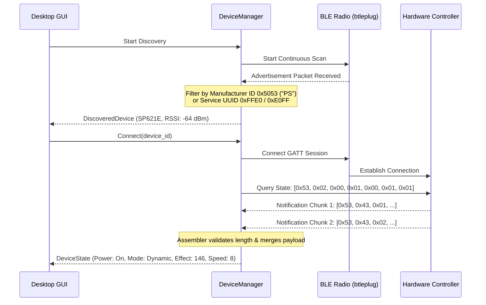

<div align="center">


# Modular Desktop Architecture Specification

**Component-Based Desktop GUI Layout, 146+ Lighting Catalog, and Responsive Windows Ergonomics**

[](#2-component-hierarchy--screen-routing)
[](#3-complete-146-lighting-styles-catalog)
[](#1-desktop-ergonomics--responsive-layout-philosophy)

<p align="center">
  <a href="../README.md"><strong>Project Root</strong></a> &bull;
  <a href="architecture.md"><strong>System Architecture</strong></a> &bull;
  <a href="protocol.md"><strong>Protocol Spec</strong></a> &bull;
  <a href="building-windows.md"><strong>Windows Guide</strong></a>
</p>

</div>

---

## 1. Desktop Ergonomics & Responsive Layout Philosophy

Native Windows desktop applications operate in a landscape aspect ratio (typically 16:9 or 16:10 at 1080p, 1440p, or 4K resolutions). Porting mobile portrait cards directly to desktop without viewport constraints causes extreme horizontal stretching, misaligned dial geometry, and truncated labels when windows are maximized.

Pyxillum solves this by adopting a **responsive multi-column desktop layout**:

```
+----------------------------------------------------------------------------------------------------+
|  [Logo] PYXILLUM               |  SP530E (Bluetooth Connected - 68 dBm)      (?) Help  [x] Settings|
|--------------------------------+-------------------------------------------------------------------|
|  DEVICES                       |  Dynamic     Solid     Music     DIY                   (P) Power  |
|  * SP530E (Active)             |-------------------------------------------------------------------|
|    SP621E Virtual              |  [================ 60 FPS Strip Simulation =====================]  |
|    SP630E (Standby)            |                                                                    |
|  [+ Add / Scan Device]         |        CENTER STAGE (Max Width: 680px)        |  PRESET CATALOG    |
|                                |                     .---.                     |  Search: [_______] |
|  NAVIGATION                    |                   /   |   \                   |  * Rainbow (1)     |
|  [x] Dynamic Lighting          |                  |   146   |  Gradient        |  * Meteor Red (16) |
|  [ ] Solid Chromatic           |                   \   |   /                   |  * Dual Snake (29) |
|  [ ] Music Reactive            |                     '---'                     |  * Wave Ripple (46)|
|  [ ] DIY Sequencer             |              <                 >              |  * Dot Spin (75)   |
|  [ ] Hardware Setup            |              (Loop) (||) (Fav) (List)         |  * Gradient (146)  |
|                                |                                               |                    |
|  STATUS                        |  Brightness [ 100% ] ========o=========       |  Categories:       |
|  Port: BLE Active              |  Speed      [   8  ] ============o=====       |  [Rainbow] [Fire]  |
|  Pacing: 30 ms (Healthy)       |                                               |  [Comet]   [Snake] |
+----------------------------------------------------------------------------------------------------+
```

### Key Principles:
1. **Left Navigation Rail (Sidebar)**: Fixed width (220 px) containing the persistent device switcher, BLE signal strength indicators, and mode navigation items.
2. **Center Stage with Bounds**: The interactive controls (radial arc dial, colour disc, sound visualizer, 14-node sequencer) are centered and constrained by `max_width: 720.0 px`. Dials never stretch oblong or clip off the right edge.
3. **Collapsible Preset Catalog Drawer**: On wide displays (> 1100 px), the full searchable 146-preset catalog sits comfortably beside the main dial without obscuring active controls.
4. **60 FPS Acrylic Strip Monitor**: Embedded at the top of the canvas, providing real-time visual feedback of pixel strip rendering.

---

## 2. Component Hierarchy & Screen Routing

The GUI crate (`crates/app`) is decomposed into modular components:

```
crates/app/
├── Cargo.toml
└── src/
    ├── main.rs                  # Windows entry point, NativeOptions, high-DPI scaling
    ├── app.rs                   # Top-level PyxillumApp state coordinator & event loop
    ├── state.rs                 # Thread-safe UI state, device models, command definitions
    ├── theme.rs                 # Windows Fluent / Acrylic dark & light visual styling
    ├── catalog.rs               # Catalog of 146+ dynamic lighting styles & sound algorithms
    ├── screens/                 # Screen-wise modular view controllers
    │   ├── mod.rs               # Screen routing trait
    │   ├── device_hub.rs        # Device discovery, BLE pairing, hardware cards, status
    │   ├── dynamic_mode.rs      # Circular radial arc dial, speed/brightness, category selector
    │   ├── solid_mode.rs        # Continuous colour disc, RGB/Hex tiles, CCT warmth slider
    │   ├── music_mode.rs        # 16-band audio spectrum, GSMTC Now Playing banner, mic switch
    │   ├── diy_mode.rs          # 14-node colour sequencer, 4 chase modes, animated strip preview
    │   └── settings_modal.rs    # Controller configuration (IC type, chip order, pixel count, safety gate)
    ├── widgets/                 # Reusable vector UI components
    │   ├── mod.rs
    │   ├── arc_dial.rs          # Scalable 270-degree arc gauge with artwork disc & step buttons
    │   ├── color_disc.rs        # Continuous radial Hue-Saturation triangle mesh wheel
    │   ├── neon_strip.rs        # 60 FPS real-time addressable LED strip simulation
    │   ├── sidebar.rs           # Desktop left navigation rail & device switcher
    │   └── effect_drawer.rs     # Searchable, filterable 146-effect preset drawer
    └── audio/                   # Windows native audio integration
        ├── mod.rs
        ├── media_session.rs     # Windows System Media Transport Controls (GSMTC) session tracker
        └── wasapi_capture.rs    # WASAPI loopback capture & real-time FFT audio analysis
```

---

## 3. Complete 146+ Lighting Styles Catalog

The controller firmware implements 146 discrete addressable SPI lighting patterns in Dynamic Mode (`0x03`), alongside 18 music-reactive patterns (`0x05`) and 18 DIY chase algorithms (`0x07`).

### 3.1 Dynamic SPI Patterns (`Mode: 0x03`, Codes `0x01` through `0x92`)

| ID Range | Category | Count | Lighting Style Names |
| :--- | :--- | :--- | :--- |
| **`0x01 - 0x08`** | **Rainbow & Spectrum** | 8 | Rainbow Flow, Rainbow Meteor, Rainbow Stars, Rainbow Spin, Rainbow Wave, Rainbow Jump, Rainbow Twinkle, Rainbow Spiral |
| **`0x09 - 0x0E`** | **Fire Heat Waves** | 6 | Fire Red-Yellow, Fire Red-Purple, Fire Green-Yellow, Fire Green-Cyan, Fire Blue-Purple, Fire Blue-Cyan |
| **`0x0F - 0x15`** | **Single Comet** | 7 | Comet Red, Comet Green, Comet Blue, Comet Yellow, Comet Cyan, Comet Purple, Comet White |
| **`0x16 - 0x1C`** | **Meteor Shower** | 7 | Meteor Red, Meteor Green, Meteor Blue, Meteor Yellow, Meteor Cyan, Meteor Purple, Meteor White |
| **`0x1D - 0x3E`** | **Dual Gradual Snake** | 34 | Dual Snake Red-Green, Red-Blue, Red-Yellow, Red-Cyan, Red-Purple, Red-White, Green-Blue, Green-Yellow, Green-Cyan, Green-Purple, Green-White, Blue-Yellow, Blue-Cyan, Blue-Purple, Blue-White, Yellow-Cyan, Yellow-Purple, Yellow-White, Cyan-Purple, Cyan-White, Purple-White, and harmonic variants |
| **`0x3F - 0x48`** | **Segment Spin** | 10 | Rotational segmented chasing across dual and triple colour pairs |
| **`0x49 - 0x58`** | **Chasing Dots & Trails**| 16 | Staggered multi-dot chasing and trailing particle effects |
| **`0x59 - 0x70`** | **Wave Ripples & Scanning**| 24 | Bidirectional scanning, bounce waves, oscillating ripple fronts |
| **`0x71 - 0x8A`** | **Orbital Dot Spins** | 26 | High-speed single and multi-dot orbital rotations |
| **`0x8B - 0x91`** | **Segmented Rotations**| 7 | Segmented rotational spin across 7 primary hues |
| **`0x92` (146)** | **Gradient** | 1 | Full-spectrum continuous spatial gradient |

### 3.2 Music-Reactive Algorithms (`Mode: 0x05`, Codes `0x01` through `0x12`)

| Code | Name | Behaviour |
| :--- | :--- | :--- |
| `0x01` | **Rhythm Spectrum Full** | Full-strip audio frequency spectrum analyzer |
| `0x02` | **Rhythm Spectrum Single** | Single-colour dynamic spectrum peak response |
| `0x03` | **Rhythm Stars Full** | Random star bursts synchronized to transient beat hits |
| `0x04` | **Rhythm Stars Single** | Monochromatic beat-burst stars |
| `0x05` | **Energy Gradient** | Progressive energy wave from center outwards (Strip Music Mode 5) |
| `0x06` | **Energy Single** | Single-hue outward energy pulse |
| `0x07` | **Pulse Gradient** | Breathing harmonic pulse tracking mid-range audio volume |
| `0x08` | **Pulse Single** | Direct amplitude pulse modulation |
| `0x09` | **Ejection Forward Full** | High-velocity forward particle ejection on bass transients |
| `0x0A` | **Ejection Forward Single** | Monochromatic forward particle ejection |
| `0x0B` | **Ejection Backward Full**| High-velocity backward particle ejection |
| `0x0C` | **Ejection Backward Single**| Monochromatic backward particle ejection |
| `0x0D` | **VU Meter Full** | Dual-ended classic analog audio volume unit meter |
| `0x0E` | **VU Meter Single** | Single-colour progressive VU meter |
| `0x0F` | **Love & Peace** | Slow ambient harmonic colour transitions |
| `0x10` | **Christmas** | Alternating holiday red-green acoustic dance |
| `0x11` | **Heartbeat** | Dual-pulse systolic and diastolic rhythm |
| `0x12` | **Party Strobe** | High-energy multi-colour transient strobe |

### 3.3 DIY Custom Chase Algorithms (`Mode: 0x07`, Codes `0x01` through `0x12`)

Sequenced across the 14 programmable nodes in the 2x7 color matrix:
- `0x01`: Static Colour
- `0x02`: Chase Forward
- `0x03`: Chase Backward
- `0x04`: Chase Middle to Out
- `0x05`: Chase Out to Middle
- `0x06`: Twinkle
- `0x07`: Fade
- `0x08 - 0x0B`: Comet Modes (Forward, Backward, Middle-Out, Out-Middle)
- `0x0C - 0x0F`: Wave Modes (Forward, Backward, Middle-Out, Out-Middle)
- `0x10`: Strobe
- `0x11`: Solid Fade
- `0x12`: Full Multi-Colour Strobe

---

## 4. Bluetooth Detection & Pairing Protocol

Pyxillum scans for pixel LED controllers using `btleplug` with a multi-layered filtering strategy:



### Safety and Rate-Limiting Rules:
- **Write Pacing**: Commands must be dispatched with a minimum interval of 30 ms between consecutive unacknowledged GATT writes.
- **EEPROM Mutation Gating**: Changing strip pixel count (`0x08`), IC chip model (`0x6A`), or RGB chip order (`0x6B`) requires explicit confirmation via the safety toggle (`--i-understand-this-changes-the-device`).
