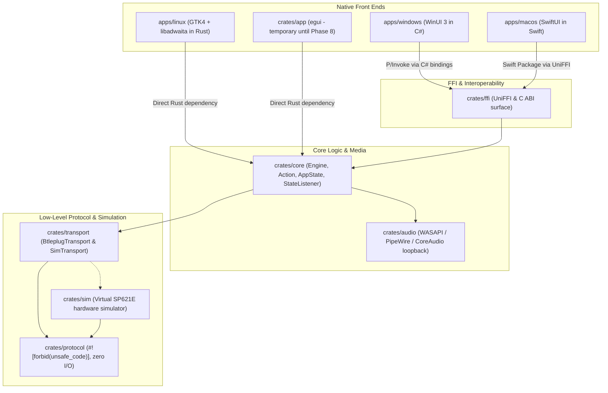

# Pyxillum Native Architecture Specification

Complete technical and architectural specification for Pyxillum V2: Rebuilding Pyxillum as a truly native, cross-platform desktop application across Windows, macOS, and Linux.

---

## 1. Executive Vision & Core Tenets

Pyxillum V2 departs from custom-drawn immediate-mode toolkits to deliver an authentic, first-class native application experience on each supported desktop platform:
- **Windows**: WinUI 3 in C# (.NET 8, Windows App SDK) with Mica, Fluent styling, and Segoe Fluent Icons.
- **macOS**: SwiftUI in Swift (macOS 13+ Ventura and Sonoma) with native AppKit menu bar, SF Symbols, and system integration.
- **Linux**: GTK 4 and libadwaita in Rust (`gtk4-rs`, `libadwaita-rs`) following GNOME Human Interface Guidelines with AdwNavigationSplitView and symbolic iconography.

### Fundamental Architectural Tenet:
**One shared Rust core owns 100% of behaviour, communication, and state. The native front ends strictly render snapshots of state and dispatch user actions.**
- Zero Electron, zero webviews, zero custom-drawn foreign widget wrappers.
- The user interface is completely decoupled from Bluetooth I/O and protocol serialization.
- Protocol bytes, device command semantics, and persisted data formats remain strictly invariant.
- Honest Capability labelling ("implemented, untested on hardware") is maintained across all platforms.

---

## 2. Workspace Topology & Boundaries

### Boundary Responsibilities:
1. **`crates/protocol`**: Pure functional codec. Strictly `#![forbid(unsafe_code)]`, zero heap allocations where possible, zero I/O, zero async.
2. **`crates/sim`**: In-memory virtual SP621E hardware simulator, rate-limit validator, and 60 FPS pixel buffer renderer.
3. **`crates/transport`**: Provides the asynchronous `Transport` trait, concrete `BtleplugTransport`, and memory-channel `SimTransport`.
4. **`crates/audio`**: Cross-platform audio loopback and microphone capture abstraction (`AudioSource` trait) with OS-specific backend implementations:
   - Windows: WASAPI process/device loopback.
   - Linux: PipeWire and PulseAudio monitor sources.
   - macOS: CoreAudio microphone capture and ScreenCaptureKit system audio recording.
5. **`crates/core`**: The single source of truth for application runtime state and business logic:
   - `enum Action`: Every distinct user intent or input event.
   - `struct AppState`: Immutable state snapshot emitted to listeners.
   - `struct Engine`: Coordinates Tokio runtime, Bluetooth transport, audio processing, and 60 FPS effects engine.
   - `trait StateListener`: Callback mechanism delivering coalesced state updates to front ends.
   - `trait PlatformServices`: Abstract hooks for OS-level actions (opening system Bluetooth settings, querying data directory, requesting permissions).
6. **`crates/ffi`**: UniFFI proc-macro interfaces exposing `Engine`, `Action`, `AppState`, and `StateListener` to Swift and C#.
7. **`apps/windows`**: WinUI 3 desktop application written in C# and XAML referencing the FFI library.
8. **`apps/linux`**: GTK 4 and libadwaita desktop application written in Rust directly consuming `crates/core`.
9. **`apps/macos`**: SwiftUI desktop application written in Swift consuming the generated Swift Package/XCFramework.

---

## 3. Global Engineering Rules

1. **Phased Execution & Quality Gate**: Work proceeds strictly phase-by-phase. No phase begins until the preceding phase passes formatting, Clippy (`-D warnings`), and test suites via `cargo xtask check`.
2. **Branch Isolation**: All development work occurs on dedicated feature branches (`dev-v2`). Never commit directly to `master`. Workflows are constrained to release and master branches so development branches avoid running unnecessary CI actions.
3. **Immutability of Hardware & Protocol Codecs**: Never alter raw protocol byte structures, timing parameters, command opcodes, or safety gates.
4. **Safety Confirmation Gate**: Modifying non-volatile device parameters (strip length, chip sequence order) requires explicit user confirmation (`--i-understand-this-changes-the-device`).
5. **Transitional Compatibility**: `crates/app` (egui) and `crates/cli` must remain fully functional through Phase 7. `crates/app` is retired only in Phase 8 after verified feature parity.
6. **Dependency Curation**: Every newly introduced dependency must be recorded in `docs/dependencies.md` with its name, licence (compatible with AGPL-3.0-or-later), and technical justification.
7. **Cross-Platform Verification Integrity**: When cross-compiling or scaffolding for an operating system not natively present on the host (e.g. macOS targets developed on a Windows machine), code must be clearly tagged as unverified in `docs/v2-progress.md`. Never claim unverified targets are operational.

---

## 4. Phase Roadmap Summary

- **Phase 0 - Baseline**: Establish `dev-v2`, initialise `docs/v2-progress.md`, document baseline metrics (`cargo xtask check`, binary sizes, test count).
- **Phase 1 - UI-Agnostic Core**: Define `Action`, `AppState`, `StateListener`, `Engine`, and `PlatformServices` in `crates/core`. Migrate scan state, preset catalogues, DIY sequencers, and safety validations out of `crates/app` into `crates/core`.
- **Phase 2 - Audio and FFI**: Implement `crates/audio` and `crates/ffi` (UniFFI surface for C# and Swift bindings). Add contract tests and minimal verification harnesses.
- **Phase 3 - Design Source of Truth**: Establish `design/tokens.json`, `design/strings.toml`, `design/icons.toml`, and platform token generation tools.
- **Phase 4 - Windows Front End**: Build `apps/windows` using WinUI 3 in C#, Mica backdrop, and native navigation.
- **Phase 5 - Linux Front End**: Build `apps/linux` using `gtk4-rs` and `libadwaita-rs` with GNOME desktop integration.
- **Phase 6 - macOS Front End**: Build `apps/macos` using SwiftUI with native AppKit menu bar, SF Symbols, and permissions handling.
- **Phase 7 - Parity, Accessibility, Packaging, CI**: Complete `docs/parity.md`, verify screen reader accessibility (Narrator, Orca, VoiceOver), and configure multi-platform packaging.
- **Phase 8 - Retire Egui**: Safely decommission `crates/app` once all native front ends achieve full parity. Open formal Pull Request documentation.
