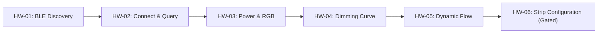

<div align="center">


# Hardware Verification Plan (SP621E Controller)

**Ordered, risk-graded test procedure and checklist for validating physical controller hardware.**

[](#1-test-execution-order-low-risk-to-high-risk)
[](#running-the-automated-cli-hardware-verification-runner)
[](#hw-06-pixel-count-and-color-order-gated-safety-command)
[](#hardware-verification-plan-sp621e-controller)

<p align="center">
  <a href="../../README.md"><strong>Project Root</strong></a> &bull;
  <a href="../../docs/protocol.md"><strong>Protocol Spec</strong></a> &bull;
  <a href="../../AGENTS.md"><strong>Agent Guidelines</strong></a>
</p>

</div>

---

This guide provides an ordered, risk-graded test procedure to verify the Pyxillum client against physical controller hardware once available.

> [!IMPORTANT]
> Until verified on real physical hardware according to this plan, all protocol implementations remain marked as **"implemented, untested on hardware"**. Completing these tests with documented evidence flips features to **`VERIFIED-HW`**.

---

## 1. Test Execution Order (Low Risk to High Risk)

Execute tests sequentially. If any test fails, STOP and report the packet anomaly before attempting higher-risk stages.



### Phase A: Non-Invasive Passive Verification (Zero Hardware Risk)

#### Test `HW-01`: BLE Advertisement & Discovery
- **Action**: Run `pyxillum scan` without `--sim`.
- **Expected Outcome**: Discover the peripheral broadcasting manufacturer ID `0x5053` (`20563`) and/or service `0xFFE0` with an RSSI reading.
- **Verification Rule**: Controller MAC address and advertised name (e.g. `SP621E...`) appear in output.

#### Test `HW-02`: GATT Connection & Status Query
- **Action**: Run `pyxillum status --address <MAC>`.
- **Precondition**: Ensure mobile companion app is force-closed (no background connection).
- **Transmitted Frame**: `a0 70 00`
- **Expected Response**: Controller streams two chunked notification packets starting with `53 43 01 17 ...` and `53 43 02 17 ...`.
- **Flip to Verified**: Verifies `0xFFE0` service, `0xFFE1` characteristic, and chunked assembly. Flips **Status Query & Notification Parser** to `VERIFIED-HW`.

---

### Phase B: Standard Operational Verification (Volatile Memory Only)

#### Test `HW-03`: Power Switching
- **Commands**:
  1. `pyxillum power on --address <MAC>` (Transmits: `a0 62 01 01`)
  2. `pyxillum power off --address <MAC>` (Transmits: `a0 62 01 00`)
- **Expected Outcome**: Attached LED strip turns on, then off.
- **Flip to Verified**: Flips **Power Toggle** to `VERIFIED-HW`.

#### Test `HW-04`: Static RGB Primary Channel Alignment
- **Commands**:
  1. Red: `pyxillum color 255 0 0 --address <MAC>` (Transmits: `a0 69 04 ff 00 00 ff`)
  2. Green: `pyxillum color 0 255 0 --address <MAC>` (Transmits: `a0 69 04 00 ff 00 ff`)
  3. Blue: `pyxillum color 0 0 255 --address <MAC>` (Transmits: `a0 69 04 00 00 ff ff`)
- **Visual Check**: Ensure red command produces red LEDs (not green or blue). If channels are swapped, record current chip order setting.
- **Flip to Verified**: Flips **Static RGB Color** to `VERIFIED-HW`.

#### Test `HW-05`: Brightness Dimming
- **Command**: `pyxillum brightness 64 --address <MAC>` (Transmits: `a0 66 01 40`)
- **Visual Check**: Output dims noticeably to ~25% luminosity without flickering.
- **Flip to Verified**: Flips **Brightness Control** to `VERIFIED-HW`.

#### Test `HW-06`: Built-in Dynamic Effects & Speed
- **Command**: `pyxillum effect 1 --speed 8 --address <MAC>` (Transmits: `a0 67 01 08` followed by `a0 63 01 01`)
- **Visual Check**: Smooth rainbow cycling across the strip at rapid playback speed.
- **Flip to Verified**: Flips **Effect Engine** to `VERIFIED-HW`.

---

### Phase C: Gated Persistent Configuration (Authorized Risk)

> [!CAUTION]
> These commands alter NVRAM state. Do not execute unless previous tests passed cleanly.

#### Test `HW-07`: Colour Order Configuration
- **Command**:
  ```bash
  pyxillum configure --chip-order grb --i-understand-this-changes-the-device --address <MAC>
  ```
- **Transmitted Frame**: `a0 64 01 02`
- **Expected Outcome**: Controller persists GRB ordering across power cycles.

---

## 2. Capturing Android HCI Bluetooth Snoop Logs for Packet Diffs

To compare Pyxillum packets byte-for-byte against the vendor application:

1. **Enable Developer Options** on Android phone:
   - Go to `Settings -> About Phone` and tap `Build Number` 7 times.
2. **Enable Bluetooth HCI Snoop Log**:
   - Go to `Settings -> Developer Options -> Enable Bluetooth HCI snoop log`.
   - Toggle Bluetooth off and on.
3. **Generate Traffic in Companion App**:
   - Open original app, toggle power, set Red, Green, Blue, and switch to Rainbow effect.
   - Force close the companion app.
4. **Pull Capture File**:
   ```bash
   adb bugreport snoop_capture.zip
   # Or directly pull btsnoop_hci.log if exposed on your device build:
   adb pull /data/misc/bluetooth/logs/btsnoop_hci.log re-workspace/btsnoop_hci.log
   ```
5. **Inspect in Wireshark**:
   - Filter by `btatt` or `btatt.opcode == 0x52` (Write Command) or `0x12` (Write Request).
   - Compare payload bytes against `docs/protocol.md` and `tests/vectors/*.json`.

---

## 3. Hardware Test Log Template

Submit completed results as an issue using `.github/ISSUE_TEMPLATE/hardware_trace.md` with:
- Controller model string (e.g. `SP621E`)
- Hardware revision number
- Pass/Fail for tests `HW-01` through `HW-07`
- Raw Wireshark hex dump (with personal MAC addresses scrubbed).

